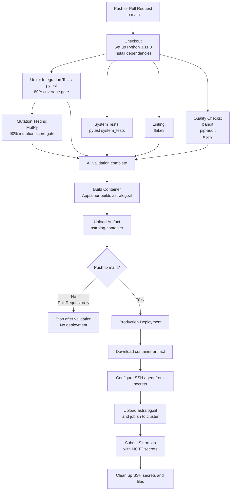

# AstraLog-HPC: Full Track Implementation
### **Software Engineering for HPC - A.Y. 2025-2026**

This repository contains the **Full Track** solution for the **AstraLog-HPC** project, developed to respond to a simulated "Call for Tenders" issued by the European Space Agency (ESA).

**Selected track**: Full

---

## AstraLog Control
Here you can access the official documentation hub and web interface for the **AstraLog-HPC** project. 

**[Click here to access AstraLog Control](https://simonereale.github.io/astralog-control/)**

---

## Team Members & Effort

| Name Surname | Person Code | Role / Main Focus | Effort (Hours) |
| :--- | :--- | :--- | :--- |
| **Alessandro Boschi** | 10861605 | Software architect, serial implementation | 27h |
| **Ondřej Faiman** | 12345678 | e.g., DevOps, CI/CD Pipeline & SLURM | XXh |
| **Aldas Lenkšas** | 12345678 | e.g., QA, Pytest & Singularity Container | XXh |
| **Stanisław Ostyk-Narbutt** | 11125177 | CI/CD pipeline, slurm, singularity/apptainer, and cluster deployment | 30h |

---

## Repository Structure

```text
.
├── res/   # input files, including sensor reading, rules and sensor configuration
│   ├── readings_alpha_large.csv
│   ├── readings_alpha_medium.csv 
│   ├── readings_alpha_small.csv
│   ├── readings_alpha_smaller.csv   # well-formed subset of the "small" dataset
|   ├── readings_sigma.csv           # handmade sensor readings
|   ├── rules_alpha.json
|   ├── rules_sigma.json             # handmade ruleset
|   ├── sensor_alpha.yaml
|   └── sensor_sigma.yaml            # handmade sensor configuration
├── src/
│   ├── astralog.py             # core of the software, orchestrates the various components
│   ├── batch_analyzer.py       # reads batch files, analyzes them and writes to output files
│   ├── batch_manager.py        # accumulates data in batches and saves them to file
│   ├── config_reader.py        # parses sensors and rules configuration files
│   ├── data_file_reader.py     # reads csv files containing sensor readings
│   ├── data_filter.py          # validates incoming sensor readings
│   ├── data_reader.py          # base class for sources of sensor reading
│   ├── data_stream_reader.py   # reads mqtt stream of sensor readings
│   ├── main.py                 # entry point, sets up AstraLog according to env / argv
│   ├── rule.py                 # classes that define the rules logic and parameters
│   ├── utils.py
│   └── __init__.py
└── tests/
│   ├── TODO
│   └── __init__.py
├── astralog.def           # TODO
├── job.sh                 # TODO 
├── requirements.txt       # python dependencies (paho-mqtt, pytest, TODO)
└── requirements-dev.txt   # TODO
```

---

## Software Organization & Architecture 

### Language and Libraries
- **Language:** python
- **Libraries:** `paho-mqtt` (for HiveMQ Broker connection), ... **to be completed/changed as needed**.

### Architecture & Relation to Phase 1
The architecture corresponds almost perfectly with the one proposed in the Phase 1 document. In the following lines we go into details of each component in the final architecture.

**AstraLog**  
One noteworthy addition is the AstraLog class: its role is to orchestrate the operation of the other components, managing aspects such as execution of parallel threads, the data reading loop and the data analysis loop.    
The AstraLog component will query data using a DataReader, filter it via the functions exposed by DataFilter and add it to the current batch passing it to BatchManager. In parallel, the BatchAnalyzer will analyze full batches.

The following components correspond in name and function as those proposed during Phase 1, and they are defined in the homonymous files.

**DataReader**  
As proposed, this component is divided into two sub-components: DataFileReader and DataStreamReader.  
DataReader itself is an abstract class that exposes the interface to query a single sensor reading. The two implementations DataFileReader and DataStreamReader manage the file and stream i/o respectively.

AstraLog will make use of the DataReader interface.

**DataFilter**  
This component corresponds to two functions:
- `validate_sensor_data_csv` to validate the csv line read from file
- `validate_sensor_data_json` to validate the json packet received via the stream.

We opted for functions rather than a dedicated class given the stateless nature of the task performed by the component.

AstraLog will call those functions after every query to DataReader

**BatchManager**  
The purpose of this component is to accumulate valid readings in batches and save them to file once a sufficient amount has been obtained or after a given amount of time has passed.

AstraLog will push the valid readings to the BatchManager.

**BatchAnalyzer**  
This class purpose is to perform the analysis of the sensor data according to the ruleset. The operation of this component can be divided into two steps: evaluation of the rules and output generation.  
In the proposed architecture, we separated those two responsibility in the sub-components RuleEvaluator and OutputHandler. This is reflected in the actual implementation where we defined the functions `analyze` and `writing_loop`, respectively.

When the batch is full, AstraLog will forward the corresponding file to the BatchAnalyzer.

### Simplifications and variations (if any)
No simplification of the architecture has been done.

The finalized architecture behave similarly to the proposed one, however, the introduction of the AstraLog component introduced some variations, due to it's role of controlling the operations of the other components. This resulted in several interactions between the components in the proposed architecture being replaced by interactions with AstraLog.  
An example is the fact that it's not the DataReader that calls DataFilter and BatchManager, but instead it's AstraLog that queries all those components.

Due to the parallelization requirements, also the behavior of BatchAnalyzer slightly diverges from the proposed one, since the RuleEvaluator will populate a queue with the output commands and the OutputHandler will perform the requested operations in parallel, without an intermediate intervention of the component that requested the analysis.  
Additionally, in the proposed architecture it's BatchManager that requests the analysis of a batch, but since the role of orchestration of the components has been moved to AstraLog, it's now the latter responsibility to initiate the BatchAnalyzer operation.

### Distribution and parallelization approach
**To be completed** 

### Usage of AI (if any)
**To be completed** 

---

## Testing & Rationale
**To be completed** 

---
## Pipeline & DevOps Workflow
An elaborate CI/CD pipeline has been implemented to ensure code quality, reliability, and seamless deployment. The pipeline includes the following stages:
- **Unit and Integration Testing:** Automated tests are executed using `pytest` with an 80% code coverage gate.
- **System Testing:** End-to-end tests validate the complete workflow of the application.
- **Linting:** Code style and formatting are enforced using `flake8`.
- **Quality Checks:** Security checks on the code are performed using `bandit`, all dependencies are scanned for vulnerabilities using `pip-audit`, and type checking is strictly enforced using `mypy`.
- **Mutation Testing:** The robustness of the test suite is evaluated using `MutPy` with a 90% mutation score gate.
- **Containerization:** The application is containerized using Apptainer, and the resulting artifact is uploaded for deployment.
- **Production Deployment:** Upon merging to the main branch, the container artifact is deployed to the cluster, and Slurm jobs are submitted with the necessary configurations and secrets.
    - The slurm job is deployed on the Galileo 100 cluster for a fixed duration to avoid unnecessary resource consumption but demonstrate the deployment process.
    - 12 hour 2FA SSH certificates are securely managed as GH secrets and refreshed when needed (i.e. before deployment to main if expired).

Secrets are securely managed and injected only when needed (i.e. not stored in artifacts or logs). 

The pipeline design can be clearly seen in the following flowchart:



---
## License
**Change this if you prefer to adopt a different license** 

This project is licensed under the **MIT License**. See the `LICENSE` file for more details.

---

## Local Setup & Usage

TODO

### Installation
Install the required dependencies:
```bash
pip install -r requirements.txt
```

### Execution
To avoid module resolution errors, always run the module from the root directory using the `-m` flag.

**Example 1: Batch every 100 valid messages**
```bash
python3 -m src.astralog_collector --mode count --limit 100 TODO
```

**Example 2: Batch every 5000 milliseconds (5 seconds)**
```bash
python3 -m src.astralog_collector --mode time --limit 5000 TODO
```

### Testing
To run the tests locally:
```bash
python3 -m pytest tests/ TODO
```

---


