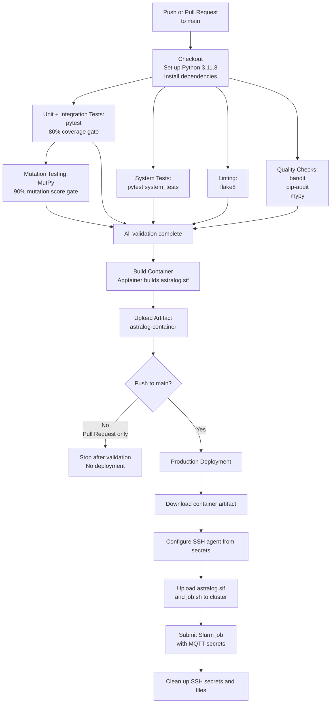

# AstraLog-HPC: Full Track Implementation
### **Software Engineering for HPC - A.Y. 2025-2026**

This repository contains the **Full Track** solution for the **AstraLog-HPC** project, developed to respond to a simulated "Call for Tenders" issued by the European Space Agency (ESA).

**Selected track**: Full

--- 

**[Click here to access AstraLog Control](https://simonereale.github.io/astralog-control/)**

---

## Team Members & Effort

| Name Surname | Person Code | Role / Main Focus | Effort (Hours) |
| :--- | :--- | :--- | :--- |
| **Alessandro Boschi** | 10861605 | Software architect, serial implementation | 27h |
| **Ondřej Faiman** | 12345678 | e.g., DevOps, CI/CD Pipeline & SLURM, Parallelization logic  | XXh |
| **Aldas Lenkšas** | 11150896 | QA, Pytest (Unit, Property-based, Integration, System testing), Mutation testing | 32h |
| **Stanisław Ostyk-Narbutt** | 11125177 | CI/CD pipeline, slurm, singularity/apptainer, and cluster deployment | 30h |

---

## Repository Structure

```text
.
├── .github/
|   └── workflows/
|       └── ci.yml  # GitHub CI/CD pipeline
├── docs/
|   └── RequirementAnalysis.pdf  # requirement analysis document produced during phase 1
├── res/            # input files, including sensor reading, rules and sensor configuration
│   ├── readings_alpha_large.csv
│   ├── readings_alpha_medium.csv 
│   ├── readings_alpha_small.csv
│   ├── readings_alpha_smaller.csv   # well-formed subset of the "small" dataset
|   ├── readings_sigma.csv           # handmade sensor readings
|   ├── rules_alpha.json
|   ├── rules_sigma.json             # handmade ruleset
|   ├── sensor_alpha.yaml
|   └── sensor_sigma.yaml            # handmade sensor configuration
├── src/
│   ├── astralog.py             # core of the software, orchestrates the various components
│   ├── batch_analyzer.py       # reads batch files, analyzes them and writes to output files
│   ├── batch_manager.py        # accumulates data in batches and saves them to file
│   ├── config_reader.py        # parses sensors and rules configuration files
│   ├── data_file_reader.py     # reads csv files containing sensor readings
│   ├── data_filter.py          # validates incoming sensor readings
│   ├── data_reader.py          # base class for sources of sensor reading
│   ├── data_stream_reader.py   # reads mqtt stream of sensor readings
│   ├── main.py                 # entry point, sets up AstraLog according to env / argv
│   ├── rule.py                 # classes that define the rules logic and parameters
│   ├── utils.py
│   └── __init__.py
└── tests/
│   ├── integration_tests/                      # integration tests
|   |   ├── data/                               # data used for testing
|   |   ├── test_integration_astralog.py        # integration tests for AstraLog
|   |   ├── test_integration_batch_analyzer.py  # integration tests for BatchAnalyzer
|   |   ├── test_integration_batch_manager.py   # integration tests for BatchManager
|   |   └── __init__.py
│   ├── system_tests/                    # system tests
|   |   ├── data/                        # data used for system tests
|   |   ├── test_system_file_based.py    # system tests to test the system in file-based mode
|   |   ├── test_system_stream_based.py  # system tests to test the system in stream-based mode
│   ├── unit_tests/                     # unit tests
|   |   ├── test_astralog.py            # unit tests for AstraLog
|   |   ├── test_batch_analyzer.py      # unit tests for BatchAnalyzer
|   |   ├── test_batch_manager.py       # unit tests for BatchManager
|   |   ├── test_config_reader.py       # unit tests for ConfigReader
|   |   ├── test_data_file_reader.py    # unit tests for DataFileReader
|   |   ├── test_data_filter.py         # unit tests for DataFilter
|   |   ├── test_data_stream_reader.py  # unit tests for DataStreamReader
|   |   ├── test_rule_property.py       # property-based tests for rules
|   |   ├── test_rule.py                # unit tests for rules
|   |   ├── test_utils.py               # unit tests for util functions
|   |   └── __init__.py
|   └── __init__.py
├── .gitignore
├── astralog.def           # container
├── job.sh                 # slurm job for running the system on the cluster
├── LICENCE
├── requirements.txt       # python dependencies required for running the system
└── requirements-dev.txt   # python dependencies required for developing the project
```

---

## Software Organization & Architecture 

### Language and Libraries
- **Language:** python
- **Libraries:** 
    - `paho-mqtt` for HiveMQ Broker connection
    - `pytest` for testing
    - `testcontainers` and `docker` for system testing
    - `flake8` linter
    - `bandit`, `mypy` and `pip-audit` for QA
    - `MutPy` for mutation testing


### Architecture & Relation to Phase 1
The architecture corresponds almost perfectly with the one proposed in the Phase 1 document. In the following lines we go into details of each component in the final architecture.

**AstraLog**  
One noteworthy addition is the AstraLog class: its role is to orchestrate the operation of the other components, managing aspects such as execution of parallel threads, the data reading loop and the data analysis loop.    
The AstraLog component will query data using a DataReader, filter it via the functions exposed by DataFilter and add it to the current batch passing it to BatchManager. In parallel, the BatchAnalyzer will analyze full batches.

The following components correspond in name and function as those proposed during Phase 1, and they are defined in the homonymous files.

**DataReader**  
As proposed, this component is divided into two sub-components: DataFileReader and DataStreamReader.  
DataReader itself is an abstract class that exposes the interface to query a single sensor reading. The two implementations DataFileReader and DataStreamReader manage the file and stream i/o respectively.

AstraLog will make use of the DataReader interface.

**DataFilter**  
This component corresponds to two functions:
- `validate_sensor_data_csv` to validate the csv line read from file
- `validate_sensor_data_json` to validate the json packet received via the stream.

We opted for functions rather than a dedicated class given the stateless nature of the task performed by the component.

AstraLog will call those functions after every query to DataReader

**BatchManager**  
The purpose of this component is to accumulate valid readings in batches and save them to file once a sufficient amount has been obtained or after a given amount of time has passed.

AstraLog will push the valid readings to the BatchManager.

**BatchAnalyzer**  
This class purpose is to perform the analysis of the sensor data according to the ruleset. The operation of this component can be divided into two steps: evaluation of the rules and output generation.  
In the proposed architecture, we separated those two responsibility in the sub-components RuleEvaluator and OutputHandler. This is reflected in the actual implementation where we defined the functions `analyze` and `writing_loop`, respectively.

When the batch is full, AstraLog will forward the corresponding file to the BatchAnalyzer.

### Simplifications and variations (if any)
No simplification of the architecture has been done.

The finalized architecture behave similarly to the proposed one, however, the introduction of the AstraLog component introduced some variations, due to it's role of controlling the operations of the other components. This resulted in several interactions between the components in the proposed architecture being replaced by interactions with AstraLog.  
An example is the fact that it's not the DataReader that calls DataFilter and BatchManager, but instead it's AstraLog that queries all those components.

Due to the parallelization requirements, also the behavior of BatchAnalyzer slightly diverges from the proposed one, since the RuleEvaluator will populate a queue with the output commands and the OutputHandler will perform the requested operations in parallel, without an intermediate intervention of the component that requested the analysis.  
Additionally, in the proposed architecture it's BatchManager that requests the analysis of a batch, but since the role of orchestration of the components has been moved to AstraLog, it's now the latter responsibility to initiate the BatchAnalyzer operation.

### Distribution and parallelization approach
**To be completed** 

### Usage of AI (if any)
**To be completed** 

**Stanislaw Ostyk-Narbutt**  
AI was used for
- helping with making the mermaid diagram (in README)
- helping with formatting of table (in README)
- finding bash commands to extract SSH keys from small step (for continuous deployment)

**Boschi Alessandro**  
AI was used to
- provide the python syntax used to express common programming concepts such as inheritance, abstract classes, error handling...
- provide descriptions of MQTT functions and simple examples of their usage
- create helper functions for JSON, CSV and YAML parsing
- list the names of common functions in python, e.g. type conversions, casting or member functions of the various collections.

---

## Testing & Rationale

The system and its components have been thoroughly tested using different testing strategies, all common and standard in the industry.

### Unit tests

Unit tests are meant to test individual functions and their expected outcomes of each system's components. 

On most of the files, >90% coverage is reached, with the 80% coverage in all the project.

80% coverage limit was also used as a threshold for the CI pipeline to pass, keeping the code tested throughout the project's development. This limit was chosen, as it is high enough to guarantee correctness of most of the system's functionality, but less than 100%, as full coverage is near-impossible (for example, unit tests cannot cover `main.py`).

### Property-based tests

Property-based testing is a common and effective technique to unit test particular properties of the components. We have focused on extensivelly testing the rule properties, such as "stateful rule is never violated until the max violations threshold is reached". These kind of tests are executed by generating many random inputs based on the defined property, and the component is tested with each of the input, expecting to give the output correctly for each of them.

### Integration tests

Integration tests are meant to ensure that the more complex functionality of the whole components and their interactions is correct. These tests also include validating that the file-reading and writing within the actual file system is done correctly in some components.

Combined with unit tests, the total coverage reached is 90% which is a very good result for the system.

### System tests

To test the whole system, several system tests were created. They treat the system as a whole by executing the python command while passing `main.py` as an argument together with correctly set environment and command line arguments. As these tests are more heavy and time-consuming, they were carefully selected to cover several main scenarios. 

Two types of tests were made. First one is to test the system that reads the input from the file. The second one is for the stream-based system. For the latter one the MQTT stream has to be instantiated which is done via docker using `testcontainers` python package.

### Mutation testing

Mutation testing is a robust bug-catching strategy, as it allows to improve test set while automatically trying out many mutants applied to the code. As the rule functionality is core at this project, we wanted to make sure that our implementation does not leave any mistakes, and ensure that the test suite for these classes is strong, we applied mutation testing for rules, reaching 100% killed mutants.

---
## Pipeline & DevOps Workflow
An elaborate CI/CD pipeline has been implemented to ensure code quality, reliability, and seamless deployment. The pipeline includes the following stages:
- **Unit and Integration Testing:** Automated tests are executed using `pytest`. Both must pass, and additionally unit tests must achieve an 80% code coverage gate to pass.
- **System Testing:** End-to-end tests validate the complete workflow of the application.
- **Linting:** Code style and formatting are enforced using `flake8`.
- **Quality Checks:** Security checks on the code are performed using `bandit`, all dependencies are scanned for vulnerabilities using `pip-audit`, and type checking is strictly enforced using `mypy`.
- **Mutation Testing:** The robustness of the test suite is evaluated using `MutPy` with a 90% mutation score gate.
- **Containerization:** The application is containerized using Apptainer, and the resulting artifact is uploaded for deployment.
- **Production Deployment:** Upon merging to the main branch, the container artifact is deployed to the cluster, and Slurm jobs are submitted with the necessary configurations and secrets.
    - The slurm job is deployed on the Galileo 100 cluster for a fixed duration to avoid unnecessary resource consumption but demonstrate the deployment process.
    - 12 hour 2FA SSH certificates are securely managed as GH secrets and refreshed when needed (i.e. before deployment to main if expired).

Secrets are securely managed and injected only when needed (i.e. not stored in artifacts or logs). 

The pipeline design can be clearly seen in the following flowchart:



---
## License

This project is licensed under the **MIT License**. See the `LICENSE` file for more details.

---

## Local Setup & Usage

### Installation
Install the required dependencies:
```bash
pip install -r requirements.txt
pip install -r requirements-dev.txt  # required only for developing and testing
```

### Execution

Run the application with:

```bash
python main.py --reading-mode <file|mqtt> --batch-mode <count|time> --limit <value> [options]
```

#### Required Arguments

| Argument         | Description                                                                                 |
| ---------------- | ------------------------------------------------------------------------------------------- |
| `--reading-mode` | Source of telemetry data. Choose `file` or `mqtt`.                                          |
| `--batch-mode`   | Batch accumulation strategy. Choose `count` or `time`.                                      |
| `--limit`        | Number of messages per batch (`count` mode) or time interval in milliseconds (`time` mode). |

#### Optional Arguments

| Argument               | Default                  | Description                                                   |
| ---------------------- | ------------------------ | ------------------------------------------------------------- |
| `--readings-file`      | `res/readings_sigma.csv` | Input readings file (used when `--reading-mode file`).        |
| `--sensors-file`       | `res/sensors_sigma.yaml` | Sensor configuration file.                                    |
| `--rules-file`         | `res/rules_sigma.json`   | Rules configuration file.                                     |
| `--output-dir`         | `out/readings`           | Directory where batch files are written.                      |
| `--valid-output-file`  | `out/valid.txt`          | File containing valid readings.                               |
| `--alarms-output-file` | `out/alarms.txt`         | File containing generated alarms.                             |
| `--duration`           | Runs indefinitely        | Number of seconds before the application stops automatically. |

#### MQTT Environment Variables
To make use of the MQTT stream as source of data, make sure to define the following environment variables before launching the program:

| Argument               | For the provided stream                               |
| ---------------------- | ----------------------------------------------------- |
| `MQTT_BROKER_URL`      | `fb2fb70e5df845aaa8ac44ead8e3c5e1.s1.eu.hivemq.cloud` |
| `MQTT_PORT`            | `8883`                                                |
| `MQTT_TOPIC`           | `esa/astralog/telemetry`                              |
| `MQTT_USER`            | `students`                                            |
| `MQTT_PASSWORD`        | `Listeningstuff26`                                    |

Optionally, you can also set `MQTT_TLS` as either `true` (default) or `false`.

#### Examples

Process readings from a file in batches of 100 messages using the default (provided) `sigma` ruleset and files:

```bash
python main.py \
  --reading-mode file \
  --batch-mode count \
  --limit 100
```

Process readings from a file every 5 seconds using the default (provided) `sigma` ruleset and files:

```bash
python main.py \
  --reading-mode file \
  --batch-mode time \
  --limit 5000
```

Run with custom input and output files:

```bash
python main.py \
  --reading-mode file \
  --batch-mode count \
  --limit 50 \
  --readings-file data/readings.csv \
  --sensors-file config/sensors.yaml \
  --rules-file config/rules.json \
  --output-dir output/batches
```

Run for a limited duration (60 seconds):

```bash
python main.py \
  --reading-mode mqtt \
  --batch-mode time \
  --limit 1000 \
  --duration 60
```

For a complete list of available options:

```bash
python main.py --help
```


### Testing
To run the tests locally:
```bash
pytest tests/  # runs all tests

# To run test groups:
pytest tests/unit_tests         # unit and property-based tests
pytest tests/integration_tests  # integration tests
pytest tests/system_tests       # system tests
```

To run mutation testing for rules:
```
mut.py \
--target src.rule \
--unit-test tests.unit_tests.test_rule \
--runner pytest \
```

---


