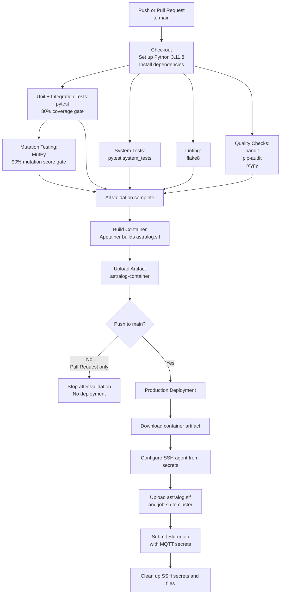

# AstraLog-HPC: Full Track Implementation
### **Software Engineering for HPC - A.Y. 2025-2026**

This repository contains the **Full Track** solution for the **AstraLog-HPC** project, developed to respond to a simulated "Call for Tenders" issued by the European Space Agency (ESA).

**Selected track**: Full

---

## AstraLog Control
Here you can access the official documentation hub and web interface for the **AstraLog-HPC** project. 

**[Click here to access AstraLog Control](https://simonereale.github.io/astralog-control/)**

---

## Team Members & Effort

**TODO**

| Name Surname | Person Code | Role / Main Focus | Effort (Hours) |
| :--- | :--- | :--- | :--- |
| **Student 1** | 12345678 | e.g., Software Architect & Backend Logic | XXh |
| **Ondřej Faiman** | 12345678 | e.g., DevOps, CI/CD Pipeline & SLURM | XXh |
| **Aldas Lenkšas** | 12345678 | e.g., QA, Pytest & Singularity Container | XXh |
| **Stanisław Ostyk-Narbutt** | 11125177 | CI/CD pipeline, slurm, singularity/apptainer, and cluster deployment | 30h |

*(Note: If your group has 3 or 4 students, explicitly describe who handled the distribution/parallelization logic below).*

---

## Repository Structure

**To be completed**

---

## Software Organization & Architecture 

**To be completed** 

### Language and Libraries
- **Language:** 🐍
- **Libraries:** `paho-mqtt` (for HiveMQ Broker connection), ... **to be completed/changed as needed**.

### Architecture & Relation to Phase 1
**To be completed** 

### Simplifications and variations (if any)
**To be completed** 

### (For groups of three and four students) Distribution and parallelization approach
**To be completed** 

### Usage of AI (if any)
**To be completed** 

---

## Testing & Rationale
**To be completed** 

---
## Pipeline & DevOps Workflow
An elaborate CI/CD pipeline has been implemented to ensure code quality, reliability, and seamless deployment. The pipeline includes the following stages:
- **Unit and Integration Testing:** Automated tests are executed using `pytest` with an 80% code coverage gate.
- **System Testing:** End-to-end tests validate the complete workflow of the application.
- **Linting:** Code style and formatting are enforced using `flake8`.
- **Quality Checks:** Security checks on the code are performed using `bandit`, all dependencies are scanned for vulnerabilities using `pip-audit`, and type checking is strictly enforced using `mypy`.
- **Mutation Testing:** The robustness of the test suite is evaluated using `MutPy` with a 90% mutation score gate.
- **Containerization:** The application is containerized using Apptainer, and the resulting artifact is uploaded for deployment.
- **Production Deployment:** Upon merging to the main branch, the container artifact is deployed to the cluster, and Slurm jobs are submitted with the necessary configurations and secrets.
    - The slurm job is deployed on the Galileo 100 cluster for a fixed duration to avoid unnecessary resource consumption but demonstrate the deployment process.
    - 12 hour 2FA SSH certificates are securely managed as GH secrets and refreshed when needed (i.e. before deployment to main if expired).

Secrets are securely managed and injected only when needed (i.e. not stored in artifacts or logs). 

The pipeline design can be clearly seen in the following flowchart:



---
## License
**Change this if you prefer to adopt a different license** 

This project is licensed under the **MIT License**. See the `LICENSE` file for more details.

---

## Instructors' notes on the current content of this template

### Current repository structure
```text
.
├── csv_input/                 # Input datasets for groups of two and three students
│   ├── export_sat_alpha_large.csv  
│   ├── export_sat_alpha_medium.csv
│   └── export_sat_alpha_small.csv
├── requirements.txt           # Python dependencies (paho-mqtt, pytest)
├── src/
│   ├── astralog_collector.py  # Core ingestion & ESA validation logic
│   └── __init__.py
└── tests/
    ├── test_collector.py      # Automated test suite
    └── __init__.py
```

### ESA Compliance & Implementation Details

The following website acts as documentation hub for the project and contains AstraLog Control, a wed dashboard that allows you to visualize the messages incoming from the spacecrafts' digital twins through the MQTT broker: https://github.com/SimoneReale/astralog-control. Please analyze its content carefully. 

Groups of two and three students will find in 'csv_input' three csv files containing sets of events generated by spacecrafts' sensors. The three sets have all the same structure and contain different amounts of data to allow you to test your system in different situations.

Groups of four students can take inspiration or can reuse the implementation in `astralog_collector.py`. It acquires data from the MQTT broker. 
`astralog_collector.py` filters incoming data to handle real-world space communication noise:
1. **Malformed JSON:** Drops packets with invalid syntax.
2. **Schema Errors:** Ensures all mandatory fields (`timestamp`, `sensor_id`, `value`, `priority`) are present.
3. **Type Errors:** Verifies that sensor `value` is numerical.

The system supports two **Batch Accumulation Strategies**:
- **Count-based:** Flushes to a timestamped `.txt` file every *N* valid messages.
- **Time-based:** Flushes to a timestamped `.txt` file every *N* milliseconds.


### Local Setup & Usage

#### 1. Installation
Install the required dependencies:
```bash
pip install -r requirements.txt
```

#### 2. Running the Collector
To avoid module resolution errors, always run the module from the root directory using the `-m` flag.

**Example 1: Batch every 100 valid messages**
```bash
python3 -m src.astralog_collector --mode count --limit 100
```

**Example 2: Batch every 5000 milliseconds (5 seconds)**
```bash
python3 -m src.astralog_collector --mode time --limit 5000
```

### Testing & Rationale

We implemented our test suite using `pytest`. The tests are located in `tests/test_collector.py`.
- **Rationale behind test cases:** The tests were designed to cover the core business logic without requiring an active MQTT connection.

To run the tests locally:
```bash
python3 -m pytest tests/
```

---


